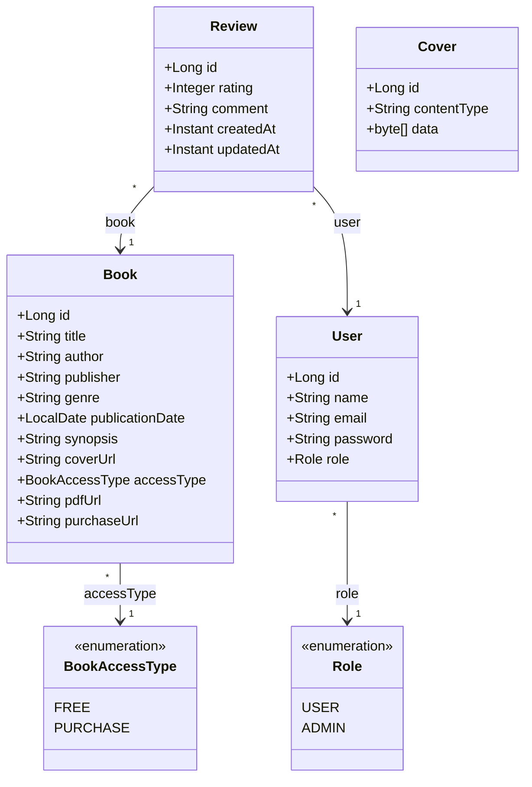

# Xopxe: camadas da arquitetura

## 1. Visão geral

O Xopxe é um site de acervo de livros. Qualquer pessoa pode ver o catálogo.
Quem tem conta pode avaliar os livros, e o admin cadastra, edita e remove
livros, além de moderar as avaliações. Os livros gratuitos abrem num leitor de
PDF dentro do site.

O sistema é dividido em duas aplicações separadas:

| Parte | Tecnologia | Porta |
|---|---|---|
| `backend/` | Java 25 + Spring Boot 4.1 | 8080 |
| `frontend/` | React 19 + Vite | 5173 |
| banco | PostgreSQL 17 | 5432 |

A versão online está em https://xopxe.vercel.app. O front fica na Vercel e o
back e o banco ficam no Render.

## 2. Camadas do back-end

O código é separado por funcionalidade (`book`, `review`, `user`, `auth`), e
dentro de cada pacote ficam as classes das camadas.

```
backend/src/main/
├── java/br/com/dominadores/xopxe/
│   ├── XopxeApplication.java     classe principal
│   ├── book/
│   │   ├── Book.java             entidade JPA
│   │   ├── BookAccessType.java   enum FREE / PURCHASE
│   │   ├── BookRepository.java   repositório
│   │   ├── BookService.java      regras de negócio
│   │   ├── BookController.java   rotas HTTP
│   │   ├── BookDtos.java         dados que entram e saem da API
│   │   ├── Cover.java            entidade JPA da imagem de capa
│   │   ├── CoverRepository.java
│   │   └── CoverController.java  envio e leitura das capas
│   ├── review/
│   │   ├── Review.java           entidade JPA
│   │   ├── ReviewRepository.java
│   │   ├── ReviewService.java
│   │   ├── ReviewController.java
│   │   └── ReviewDtos.java
│   ├── user/
│   │   ├── User.java             entidade JPA
│   │   ├── Role.java             enum USER / ADMIN
│   │   ├── UserRepository.java   repositório
│   │   └── DatabaseUserDetailsService.java
│   ├── auth/
│   │   ├── AuthController.java   login, cadastro e logout
│   │   ├── AuthDtos.java
│   │   ├── SessionLogin.java     abre e fecha a sessão
│   │   ├── GoogleLoginSettings.java
│   │   └── GoogleLoginSuccessHandler.java
│   └── config/
│       ├── SecurityConfig.java   permissões, CORS e senha
│       ├── ApiExceptionHandler.java
│       ├── OpenApiConfig.java    Swagger
│       ├── BookSeeder.java       livros iniciais
│       └── DemoUsersSeeder.java  usuários de teste
└── resources/
    ├── application.yaml
    ├── seed/books.json           catálogo inicial
    └── db/migration/             scripts do Flyway que criam as tabelas
```

### Entidades (JPA)

`Book`, `User`, `Review` e `Cover` são as classes anotadas com `@Entity`. Cada uma
representa uma tabela do banco.

```java
@Entity
@Table(name = "books")
public class Book {
    @Id @GeneratedValue(strategy = GenerationType.IDENTITY)
    private Long id;

    @Column(nullable = false)
    private String title;
    // ...
}
```

Quem cria as tabelas é o Flyway, com os scripts SQL em `db/migration/` (V1 a
V6). O Hibernate está configurado com `ddl-auto: validate`, ou seja, ele só
confere se as entidades batem com o banco e não altera nada.

### DTOs

São os `record`s de `AuthDtos`, `BookDtos` e `ReviewDtos`. Servem para separar
o que trafega na API do que está no banco.

Os de entrada são validados com `@NotBlank`, `@Email`, `@Size`, `@Min` e
`@Max`. Os de saída são montados a partir da entidade por um método
`from(...)`. O `UserResponse`, por exemplo, não tem o campo de senha, então a
senha nunca vai para o front.

### Repositórios

São interfaces que estendem `JpaRepository`. O Spring Data cria a consulta a
partir do nome do método.

```java
public interface UserRepository extends JpaRepository<User, Long> {
    Optional<User> findByEmail(String email);
    boolean existsByEmail(String email);
}
```

Métodos como `save`, `findById`, `findAll` e `delete` já vêm prontos.

### Serviços

Ficam entre o controlador e o repositório e guardam as regras de negócio.

O `BookService` lista os livros (com busca por título ou autor e filtro por
gênero), busca um livro pelo id (404 se não existir), cadastra, edita e apaga.
No cadastro e na edição ele confere o tipo de acesso: livro `FREE` precisa do
link do PDF e livro `PURCHASE` precisa do link de compra.

O `ReviewService` cuida das avaliações. Cada usuário tem no máximo uma
avaliação por livro: se ele mandar de novo, a anterior é atualizada. O usuário
pode apagar a própria avaliação, e o admin pode apagar a de qualquer pessoa.

### Controladores

São as classes `@RestController` com as rotas:

| Método | Rota | Acesso |
|---|---|---|
| POST | `/api/auth/register` | público |
| POST | `/api/auth/login` | público |
| POST | `/api/auth/logout` | público |
| GET | `/api/auth/providers` | público |
| GET | `/api/auth/me` | logado |
| GET | `/api/books` | público |
| GET | `/api/books/{id}` | público |
| POST | `/api/books` | ADMIN |
| PUT | `/api/books/{id}` | ADMIN |
| DELETE | `/api/books/{id}` | ADMIN |
| POST | `/api/books/covers` | ADMIN |
| GET | `/api/books/covers/{id}` | público |
| GET | `/api/books/{id}/reviews` | público |
| PUT | `/api/books/{id}/reviews/mine` | logado |
| DELETE | `/api/books/{id}/reviews/mine` | logado |
| DELETE | `/api/reviews/{id}` | ADMIN |

A documentação das rotas também fica no Swagger, em `/swagger-ui.html`.

### Segurança

`SecurityConfig` define quem acessa o quê (tabela acima), libera o endereço do
front no CORS e registra o `BCryptPasswordEncoder`, usado para gravar a senha
com hash. O usuário logado fica guardado na sessão (cookie `JSESSIONID`).

Dá para entrar com e-mail e senha ou com a conta do Google. O
`GoogleLoginSuccessHandler` procura o usuário pelo e-mail (ou cria um novo,
com papel USER) e abre a sessão do mesmo jeito que o login com senha.

`ApiExceptionHandler` transforma os erros em um JSON simples com a mensagem, e
`DatabaseUserDetailsService` ensina o Spring Security a buscar o usuário na
nossa tabela.

### Dados iniciais

Quando o banco está vazio, o `DemoUsersSeeder` cria os usuários de teste e o
`BookSeeder` cadastra os livros de `seed/books.json`. Esse arquivo é gerado
pelo `frontend/importador.js`, que busca livros no Internet Archive e no
Google Books.

## 3. Camadas do front-end

```
frontend/src/
├── main.jsx        inicia o React e carrega o CSS global
├── App.jsx         troca de página e guarda o usuário logado
├── pages/          telas inteiras: MainPage e BookRegistration
├── components/     peças da tela (Header, SearchBar, Filters, BooksCatalog,
│                   BooksInfo, DefaultInfo, BookForm, AccountMenu,
│                   ReviewForm, ReviewList, PdfReader, Toast)
├── api/            chamadas ao back-end (auth, books, reviews)
├── data/           listas fixas (gêneros, faixas de ano) e as estrelas
├── styles/         todo o CSS
└── assets/         imagens
```

Cada componente tem um arquivo de CSS com o mesmo nome em `styles/`, importado
por ele. Os arquivos globais (`tokens.css` com as cores e fontes, `base.css`
com o reset e `panel.css`) são carregados no `main.jsx`. As classes seguem o
padrão BEM, como `.book-card__title`.

O estado fica no componente pai que precisa dele e desce por props. O `App`
guarda a página atual e o usuário logado; a `MainPage` guarda a lista de
livros, a busca, os filtros e o livro selecionado.

Todas as chamadas passam pelo `api/client.js`. Os caminhos começam com `/api`
e quem repassa para o back-end é o Vite (em desenvolvimento), o nginx (no
Docker) ou a Vercel (online). Assim o site e a API ficam no mesmo endereço e o
navegador manda o cookie da sessão sem configuração extra.

## 4. Diagrama de classes

As quatro entidades do banco e os dois enums.



`User` vira a tabela `users`, com o e-mail único e a senha gravada em hash
(fica vazia em quem entrou pelo Google). `Book` vira a tabela `books`. O
`accessType` diz se o livro é gratuito (`FREE`, com `pdfUrl`) ou à venda
(`PURCHASE`, com `purchaseUrl`).

`Review` vira a tabela `reviews` e liga um usuário a um livro, com a nota de 1
a 5 e um comentário opcional. A tabela tem uma restrição `UNIQUE (book_id,
user_id)`, que impede duas avaliações da mesma pessoa no mesmo livro.

`Cover` vira a tabela `covers` e guarda a imagem de capa escolhida no
formulário. O admin escolhe o arquivo no computador, o front envia para
`POST /api/books/covers` e recebe o endereço `/api/books/covers/{id}`, que vai
para o `coverUrl` do livro. A imagem fica no banco, e não numa pasta, porque o
disco do Render é apagado a cada deploy. Só são aceitos JPG, PNG, WEBP e GIF
de até 2 MB.

## 5. Como rodar

```bash
./run.sh          # sobe tudo com Docker em http://localhost:8000
./dev.sh          # para programar: banco, back-end e front-end com recarga
./dev.sh --stop   # para o banco
```

Com o `./dev.sh` o site abre em `http://localhost:5173` e a API em
`http://localhost:8080`. O passo a passo completo está no `INSTALACAO.md`.

Usuários de teste (senha `password` quando roda no computador):

| E-mail | Papel |
|---|---|
| `admin@xopxe.com` | ADMIN |
| `user@xopxe.com` | USER |
